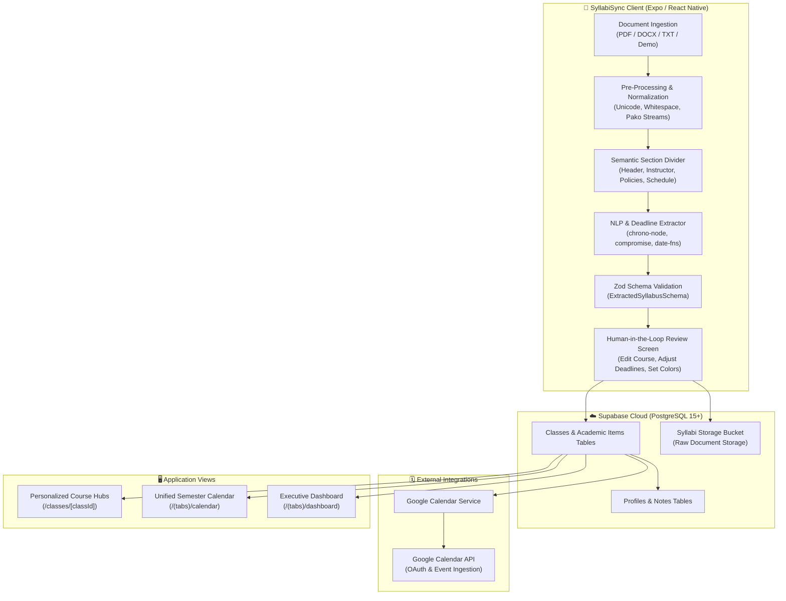

<p align="center">
  
</p>

<p align="center">
  <strong>Your syllabus. Your semester. In sync.</strong>
</p>

<p align="center">
  <a href="https://expo.dev"></a>
  <a href="https://reactnative.dev"></a>
  <a href="https://www.typescriptlang.org"></a>
  <a href="https://supabase.com"></a>
  <a href="https://developers.google.com/calendar"></a>
  <a href="./LICENSE"></a>
</p>

---

## 📌 Table of Contents

- [Overview](#-overview)
- [The Problem & The Solution](#-the-problem--the-solution)
- [Key Features](#-key-features)
- [System Architecture](#-system-architecture)
- [Document Extraction Engine](#-document-extraction-engine)
- [Technology Stack](#-technology-stack)
- [Project Structure](#-project-structure)
- [Database Schema](#-database-schema)
- [Getting Started](#-getting-started)
  - [Prerequisites](#1-prerequisites)
  - [Installation](#2-installation)
  - [Environment Setup](#3-environment-setup)
  - [Database Migration](#4-database-migration)
  - [Running the App](#5-running-the-app)
- [Hackathon Demo Walkthrough](#-hackathon-demo-walkthrough)
- [Contributing](#-contributing)
- [License](#-license)

---

## 🌟 Overview

**SyllabiSync** is a modern, cross-platform academic command center engineered for university students. It eliminates the chaos of juggling 15-page syllabus documents by converting unstructured PDF and Word (`.docx`) course syllabi into clean, interactive course dashboards, unified chronological deadline timelines, and two-way synchronized Google Calendar schedules.

Built with **Expo SDK 58**, **React Native**, **TypeScript**, and **Supabase**, SyllabiSync combines deterministic, zero-hallucination document extraction with human-in-the-loop review, offline-first reactivity, and responsive design across desktop web and mobile.

---

## 💡 The Problem & The Solution

| The Student Dilemma 🛑 | The SyllabiSync Solution ✨ |
| :--- | :--- |
| **Information Fragmentation:** 4–6 different courses with 10–20 page syllabi buried in Canvas, Blackboard, or email threads. | **Centralized Command Center:** Upload every syllabus once and instantly access organized course hubs with textbooks, policies, and contacts. |
| **Missed Deadlines & Conflicting Exams:** Overlapping project milestones, homework, and exams scattered across static documents. | **Unified Cross-Course Calendar:** An aggregated chronological agenda with intuitive status filtering and overdue warnings. |
| **Manual Calendar Entry Burnout:** Spending the first week of every semester copying dozens of dates into Google Calendar by hand. | **One-Click Google Calendar Sync:** Automatic synchronization with stored event mapping and duplicate prevention. |
| **Unreliable AI Hallucinations:** Generic LLMs often fabricate dates, misread office hours, or miscategorize assignments. | **Deterministic Extraction + Validation:** Programmatic section division, NLP date parsing, source quote provenance, and Zod schema validation with human review. |

---

## 🚀 Key Features

### 1. 📄 Multi-Format Syllabus Ingestion
- Supports syllabus uploads via **PDF (`.pdf`)**, **Microsoft Word (`.docx`, `.doc`)**, and **Plain Text (`.txt`)**.
- Built-in **Scanned Document Detection** that identifies image-only PDFs and informs users when OCR is required.
- **1-Click Demo Syllabi**: Instant evaluation with preloaded syllabi (*CS 350: Operating Systems* and *ECON 201: Macroeconomics*) without requiring manual file uploads.

### 2. 🧠 Deterministic Extraction Engine (Zero Hallucinations)
- **Text Normalization**: Strips non-breaking whitespace, standardizes typographic quotes, resolves fractions, and unifies bullet delimiters.
- **Semantic Section Segmentation**: Classifies course text into distinct contextual blocks: Course Details, Instructor Info, Course Description, Textbooks, Grading Policies, Late/Attendance Rules, and Weekly Schedules.
- **Entity & Deadline Recognition**: Employs `compromise` NLP and `chrono-node` to parse complex academic schedules while strictly filtering out non-deadline dates (e.g., Thanksgiving break, drop deadlines, reading periods).
- **Transparency & Provenance**: Associates each extracted item with a confidence score and the exact verbatim snippet from the source document.
- **Strict Zod Validation**: Validates all structured data against runtime schemas before committing to state.

### 3. ✍️ Human-in-the-Loop Review & Verification
- Pre-save inspection screen allowing students to verify extracted details before database commit.
- Edit course titles, course codes, instructor emails, office hours, and custom color accents.
- Modify deliverable dates, adjust point weights, re-classify item types (Assignment, Exam, Quiz, Project, Reading), or add custom tasks on the fly.

### 4. 📊 Personalized Course Hubs (`/classes/[classId]`)
- **Real-Time Progress Tracking**: Visual progress bars tracking completed deliverables against total semester coursework.
- **Coursework Breakdown**: Dedicated tabs for **Assignments**, **Exams & Quizzes**, **Policies**, and **Course Notes**.
- **Grading Weight Visualization**: Clear breakdown of course grading criteria (e.g., Projects 40%, Midterm 25%, Final 30%, Homework 5%).
- **Integrated Note-Taking**: In-app lecture and syllabus note management with timestamped persistence.
- **Course Lifecycle Management**: Archive completed courses or delete them with safety confirmations.

### 5. 📅 Unified Semester Agenda & Calendar (`/(tabs)/calendar`)
- Cross-course aggregated timeline displaying all upcoming deadlines in chronological order.
- Filter by specific course, item type, or calendar sync status (`All`, `Synced`, `Not Synced`).
- Deep item detail modal displaying source syllabus excerpts, point totals, and Google Calendar sync IDs.
- Quick status toggle: mark tasks as `pending`, `in_progress`, or `completed` directly from the schedule.

### 6. 🔄 Google Calendar Synchronization
- Direct synchronization of academic deadlines into Google Calendar.
- Supports both all-day calendar events and specific time blocks.
- **Sync Deduplication**: Tracks `google_event_id` and sync timestamps to prevent double bookings or repeat events.
- **Offline-First Resilience**: Seamless transition between Supabase PostgreSQL and local `AsyncStorage` cache for guest or offline sessions.

### 7. 📱 Universal Responsive UI
- **Adaptive Productivity Shell**:
  - **Desktop / Web**: Notion- and Linear-inspired persistent sidebar navigation with brand assets, quick actions, and keyboard accessibility.
  - **Mobile (iOS & Android)**: Ergonomic bottom navigation tab bar optimized for thumb reach, native gestures, and safe area insets.
- **Modern Theme System**: Slate & University Blue color palette with semantic badge highlights, light/dark mode foundations, and Lucide React Native iconography.

---

## 🏗️ System Architecture

The following diagram illustrates the end-to-end data flow from document upload to calendar synchronization:



---

## 🔬 Document Extraction Engine

SyllabiSync utilizes an in-house programmatic extraction engine (`src/lib/syllabusEngine.ts`) designed to run both server-side via Expo API routes and client-side as an offline fallback:

```
Raw File (PDF / DOCX)
  │
  ├── 1. Extraction Layer ────► PDF.js / pako binary stream / mammoth (DOCX)
  │
  ├── 2. Sanitization ────────► Unicode normalization, whitespace collapsing
  │
  ├── 3. Sectioning ──────────► Regex heuristics partition schedule, grading, & contacts
  │
  ├── 4. Extraction & NLP ────► Course codes regex, email pattern matching,
  │                             chrono-node date detection, compromise POS tagging
  │
  ├── 5. Filtering ───────────► Strips non-academic dates (holidays, breaks, add/drop)
  │
  └── 6. Validation ──────────► Strict Zod schema parsing & confidence attribution
```

---

## 🛠️ Technology Stack

| Domain | Technology / Library | Purpose |
| :--- | :--- | :--- |
| **Mobile & Web Framework** | [Expo (SDK 58)](https://expo.dev) / [React Native 0.88](https://reactnative.dev) | Cross-platform core targeting iOS, Android, and Web |
| **Navigation & Routing** | [Expo Router (v58)](https://docs.expo.dev/router/introduction/) | Typed file-based routing with layouts and API routes |
| **Language & Typings** | [TypeScript 5.8](https://www.typescriptlang.org) | Strict type safety across database models and services |
| **Backend & Database** | [Supabase](https://supabase.com) (PostgreSQL 15+) | Relational storage, Row Level Security (RLS), and Auth |
| **Document Parsing** | `pdfjs-dist`, `pako`, `mammoth` | PDF and DOCX text decompression and reading |
| **NLP & Date Extraction**| `chrono-node`, `compromise`, `date-fns` | Context-aware academic date and deadline recognition |
| **Data Validation** | [Zod](https://zod.dev) | Schema enforcement and runtime type checking |
| **Icons & Design** | `lucide-react-native`, Custom Design Tokens | Consistent, accessible, modern productivity interface |
| **Calendar Sync** | Google Calendar REST API & OAuth | Real-time event synchronization and tracking |
| **Local Persistence** | `@react-native-async-storage/async-storage` | Offline-first caching and guest mode support |

---

## 📁 Project Structure

```
SyllabiSync/
├── assets/
│   ├── images/
│   │   ├── Logo.png                    # SyllabiSync official banner logo
│   │   ├── icon.png                    # App launcher icon
│   │   ├── splash-icon.png             # Splash screen graphic
│   │   └── android-icon-*.png          # Android adaptive icons
│   └── expo.icon/                      # iOS app icon assets
├── src/
│   ├── app/
│   │   ├── _layout.tsx                 # Root layout, Supabase auth provider, theme
│   │   ├── index.tsx                   # Auth gate and routing coordinator
│   │   ├── (auth)/
│   │   │   ├── login.tsx               # Student sign-in screen
│   │   │   ├── signup.tsx              # Student registration screen
│   │   │   └── _layout.tsx             # Auth stack wrapper
│   │   ├── (tabs)/
│   │   │   ├── _layout.tsx             # Responsive tab / sidebar layout
│   │   │   ├── dashboard.tsx           # Semester overview and KPI metrics
│   │   │   ├── classes.tsx             # Enrolled course list & archive filters
│   │   │   ├── calendar.tsx            # Unified cross-course calendar & Google sync
│   │   │   └── settings.tsx            # Account settings & integration toggles
│   │   ├── classes/
│   │   │   ├── [classId].tsx           # Individual course dashboard (tabs & notes)
│   │   │   ├── create.tsx              # Manual course creation form
│   │   │   ├── upload-syllabus.tsx     # File uploader, demo syllabi selector
│   │   │   └── review-syllabus.tsx     # Interactive AI/engine review and editor
│   │   └── api/
│   │       └── analyze-syllabus+api.ts # Server-side document processing route
│   ├── components/
│   │   ├── common/                     # Logo, Button, Card, Badge, Input, Header
│   │   ├── dashboard/                  # StatCard, metric widgets
│   │   ├── classes/                    # ClassCard, grading charts
│   │   ├── assignments/                # TaskItem with status checkboxes
│   │   └── layout/                     # ResponsiveShell (Desktop sidebar / Mobile tabs)
│   ├── constants/
│   │   ├── colors.ts                   # Theme palettes, course color swatches
│   │   └── theme.ts                    # Spacing, typography scale, border radiuses
│   ├── hooks/
│   │   ├── useAuth.tsx                 # Supabase session and user context
│   │   ├── useResponsive.ts            # Viewport width detection hook
│   │   └── useReviewData.ts            # In-memory store for pending syllabus review
│   ├── lib/
│   │   ├── syllabusEngine.ts           # Orchestrator for deterministic extraction
│   │   ├── pdfExtractor.ts             # PDF text extraction and scanned detection
│   │   ├── textProcessor.ts            # Unicode and whitespace normalization
│   │   ├── sectionDivider.ts           # Semantic section identification
│   │   ├── courseInfoExtractor.ts      # Course code, professor, and policy parsing
│   │   ├── deadlinesExtractor.ts       # Chrono-node deadline extraction & filtering
│   │   └── supabase.ts                 # Supabase client initialization
│   ├── services/
│   │   ├── class.service.ts            # Course CRUD and archive management
│   │   ├── academic-item.service.ts    # Tasks, deliverables, and status updates
│   │   ├── ai-syllabus.service.ts      # Extraction coordination and demo datasets
│   │   ├── google-calendar.service.ts  # Google Calendar API integration
│   │   ├── notes.service.ts            # Course notes CRUD
│   │   └── syllabus.service.ts         # Document storage management
│   └── types/
│       ├── database.ts                 # Database interfaces and enums
│       └── academic.ts                 # Zod validation schemas
├── supabase/
│   └── migrations/
│       └── 20261123_init_syllabisync.sql # Complete PostgreSQL DDL & RLS script
├── app.json                            # Expo configuration
├── package.json                        # Project dependencies and npm scripts
└── tsconfig.json                       # TypeScript compiler options
```

---

## 🗄️ Database Schema

SyllabiSync leverages a relational PostgreSQL database on Supabase secured by Row Level Security (RLS):

- **`profiles`**: Stores student identity details, display names, and profile timestamps.
- **`classes`**: Holds course codes (`CS 350`), names, professors, contact emails, office hours, grading breakdowns (JSONB), course policies, and archive flags.
- **`syllabi`**: Tracks uploaded source files, storage bucket paths, file metadata, and raw text representations.
- **`academic_items`**: Deliverables across all courses (`assignment`, `exam`, `quiz`, `project`, `reading`). Tracks due dates, points, completion status (`pending`, `in_progress`, `completed`), confidence scores, source quotes, and Google Calendar event IDs.
- **`notes`**: Student course notes linked to classes with timestamps and search capabilities.
- **`google_calendar_connections`**: Stores Google Calendar connection state, linked account emails, and sync timestamps.
- **`syllabi` Storage Bucket**: Secure document bucket with user-isolated RLS storage policies.

---

## ⚡ Getting Started

### 1. Prerequisites
- **Node.js** (v18.x or later)
- **npm**, **pnpm**, or **bun**
- (Optional) **Expo Go** on your physical iOS or Android device, or an iOS Simulator / Android Emulator.

### 2. Installation
Clone the repository and install project dependencies:
```bash
git clone https://github.com/your-username/SyllabiSync.git
cd SyllabiSync
npm install
```

### 3. Environment Setup
Copy the sample environment file to `.env`:
```bash
cp .env.example .env
```

Configure your credentials in `.env`:
```env
# Supabase Configuration (Required for database and authentication)
EXPO_PUBLIC_SUPABASE_URL=https://your-project.supabase.co
EXPO_PUBLIC_SUPABASE_KEY=your-supabase-anon-key

# Google Gemini API Key (Optional: for server-side AI extraction route)
EXPO_PUBLIC_GEMINI_API_KEY=your-gemini-api-key
```

> **Note**: SyllabiSync includes a standalone offline-first and guest mode. You can launch and test all features immediately even before configuring cloud keys!

### 4. Database Migration
1. Log in to your [Supabase Dashboard](https://database.new).
2. Open the **SQL Editor** tab.
3. Paste and execute the contents of [`supabase/migrations/20261123_init_syllabisync.sql`](./supabase/migrations/20261123_init_syllabisync.sql).
4. Verify that tables (`classes`, `academic_items`, `notes`, etc.) and the `syllabi` storage bucket are created.

### 5. Running the App

Start the Expo development server:
```bash
npx expo start
```

Target a specific platform directly:
```bash
# Run in your web browser (Desktop productivity view)
npx expo start --web

# Run on iOS Simulator (macOS required)
npx expo start --ios

# Run on Android Emulator
npx expo start --android
```

### Code Quality & Validation
Run type checks and linters before committing:
```bash
# TypeScript strict type checking
npx tsc --noEmit

# ESLint code style verification
npx expo lint
```

---

## 🏆 Hackathon Demo Walkthrough

Follow this 5-minute walkthrough to test all features of SyllabiSync:

1. **Launch the Application**: Run `npx expo start --web` and open the app in your browser.
2. **Access Dashboard**: Sign up for an account or select guest access to enter the dashboard.
3. **Upload Syllabus**:
   - Navigate to **Classes** → Click **Upload Syllabus**.
   - Either select a local `.pdf` or `.docx` syllabus file or click on one of the **1-Click Sample Syllabi** (*CS 350* or *ECON 201*).
4. **Inspect Extraction**:
   - Click **Start Analysis**. The engine reads the document, segments sections, and extracts metadata.
5. **Review & Confirm**:
   - On the **Review Syllabus** screen, preview the detected course title, professor email, grading breakdown, and deliverables.
   - Adjust any dates or add a task, then click **Confirm & Save Course**.
6. **Explore Course Hub**:
   - Visit the new course dashboard. Toggle between *Overview*, *Assignments*, *Exams*, *Policies*, and *Notes*.
   - Mark an assignment completed to watch the course progress bar update dynamically.
7. **Unified Calendar**:
   - Open **Calendar & Sync** from the navigation.
   - Filter by deliverable type (*Exams* or *Assignments*).
8. **Sync with Google Calendar**:
   - Click **Connect Google Calendar**, input your student email, and click **Sync to Google Calendar** to simulate two-way event scheduling.

---

## 🛣️ Roadmap

- [ ] **Direct LMS Integration**: Native import from Canvas, Blackboard, and Brightspace via REST APIs.
- [ ] **AI Study Scheduler**: Automatic generation of study blocks and preparation milestones leading up to major exams.
- [ ] **Study Group Collaboration**: Share extracted course schedules and lecture notes with classmates.
- [ ] **Native Mobile Notifications**: Push reminders 24 hours and 1 hour before assignments and exam dates.

---

## 🤝 Contributing

Contributions, feedback, and pull requests are welcome!

1. Fork the Project
2. Create your Feature Branch (`git checkout -b feature/AmazingFeature`)
3. Commit your Changes (`git commit -m 'feat: Add some AmazingFeature'`)
4. Push to the Branch (`git push origin feature/AmazingFeature`)
5. Open a Pull Request

---

## 📄 License

Distributed under the MIT License. See [`LICENSE`](./LICENSE) for more details.

---

<p align="center">
  Built with ❤️ for students everywhere.
</p>
